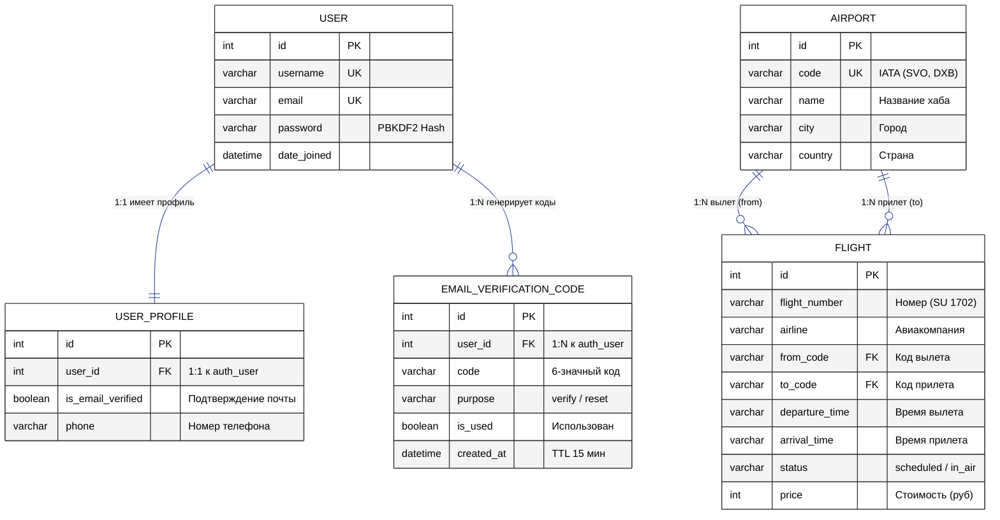

# ER-диаграмма базы данных (Entity-Relationship Diagram)

В данном документе представлена компактная **ER-диаграмма реляционной базы данных** веб-сервиса **Flight Tracker** (СУБД SQLite 3 / Django ORM).

Схема оптимизирована по ГОСТу: оставлены только ключевые атрибуты (PK, FK, UK и главные бизнес-поля), что делает диаграмму компактной, легко читаемой и идеально подходящей для вставки в лист А4 отчёта.

---

## 1. Готовое изображение ER-диаграммы (для вставки в отчёт Word)

*Файлы диаграммы высокой четкости (300 DPI) для пояснительной записки:*
* **PNG формат:** [`docs/er_diagram.png`](file:///c:/Users/faizr/PycharmProjects/KursovayaRPI/docs/er_diagram.png)
* **Векторный SVG формат:** [`docs/er_diagram.svg`](file:///c:/Users/faizr/PycharmProjects/KursovayaRPI/docs/er_diagram.svg)

---

## 2. Компактная ER-диаграмма в нотации Mermaid

---

## 3. Сводная таблица связей

| Отношение | Тип связи | Внешний ключ (FK) | Ограничения целостности | Назначение |
| :--- | :---: | :--- | :--- | :--- |
| **USER $\leftrightarrow$ USER_PROFILE** | **1 : 1** | `user_id` $\rightarrow$ `User.id` | `UNIQUE`, `ON DELETE CASCADE` | Личный профиль с флагом подтверждения email |
| **USER $\leftrightarrow$ EMAIL_VERIFICATION_CODE** | **1 : N** | `user_id` $\rightarrow$ `User.id` | `ON DELETE CASCADE` | Временные 6-значные коды (TTL 15 мин) |
| **AIRPORT $\leftrightarrow$ FLIGHT (вылет)** | **1 : N** | `from_code` $\rightarrow$ `Airport.code` | Логическая целостность | Привязка рейса к аэропорту отправления |
| **AIRPORT $\leftrightarrow$ FLIGHT (прилёт)** | **1 : N** | `to_code` $\rightarrow$ `Airport.code` | Логическая целостность | Привязка рейса к аэропорту назначения |
