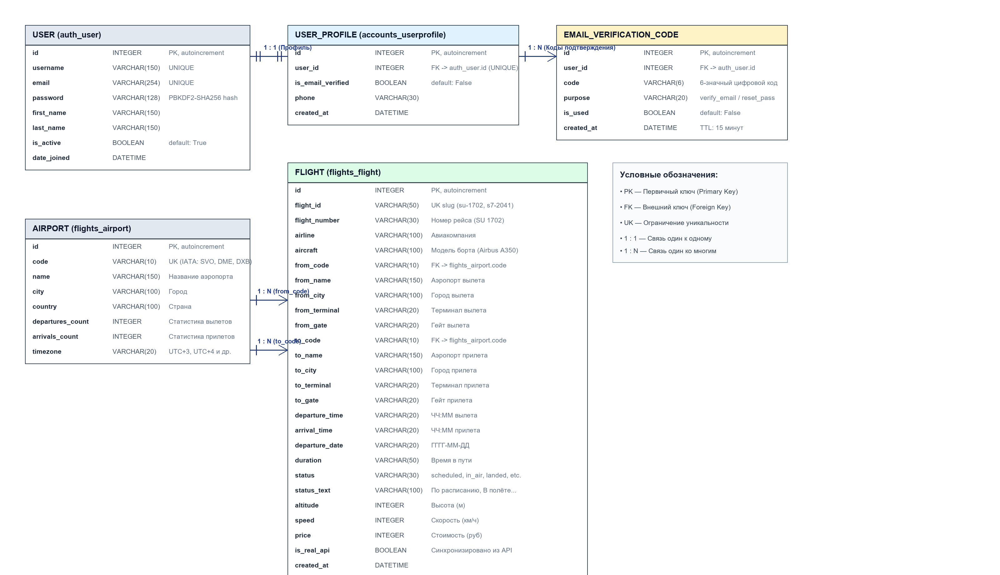
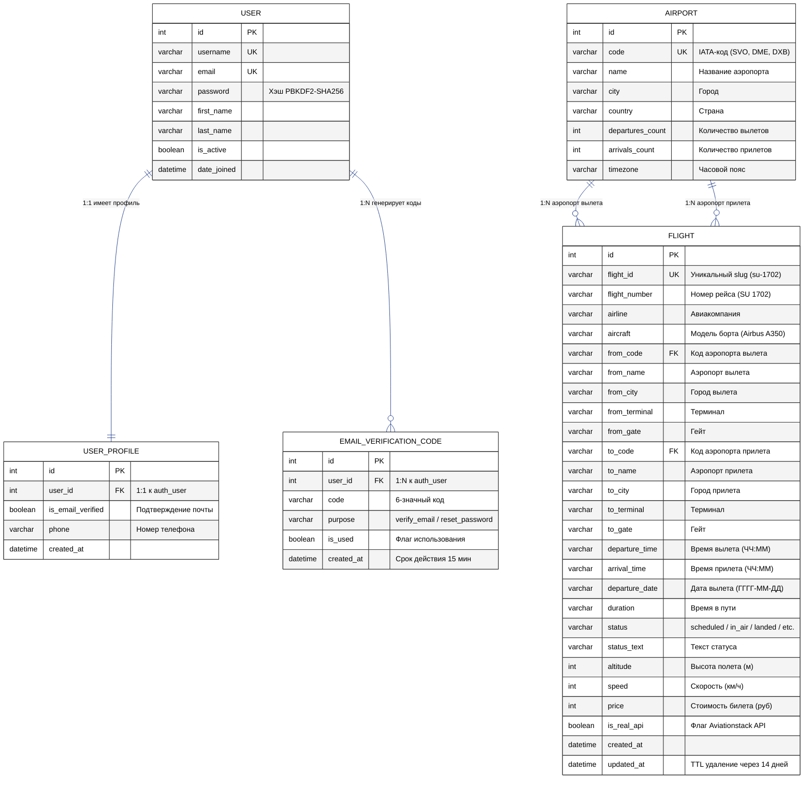

# ER-диаграмма базы данных (Entity-Relationship Diagram)

В данном документе представлена **ER-диаграмма реляционной базы данных** веб-сервиса **Flight Tracker**, спроектированной на базе СУБД SQLite 3 с использованием Django ORM.

Схема выполнена в строгом академическом стиле на **чистом белом фоне** для вставки в пояснительную записку к курсовой работе (ГОСТ).

---

## 1. Готовое изображение ER-диаграммы (для вставки в отчёт Word)

*Файлы диаграммы высокой четкости (300 DPI) для пояснительной записки:*
* **PNG формат:** [`docs/er_diagram.png`](file:///c:/Users/faizr/PycharmProjects/KursovayaRPI/docs/er_diagram.png)
* **Векторный SVG формат:** [`docs/er_diagram.svg`](file:///c:/Users/faizr/PycharmProjects/KursovayaRPI/docs/er_diagram.svg)

---

## 2. ER-диаграмма в нотации Mermaid

---

## 3. Описание сущностей и реляционных связей

### 1. `auth_user` (Пользователи системы)
Базовая таблица аутентификации Django. Хранит учетные данные: уникальные логин и email, а также хэш пароля (криптостойкий алгоритм **PBKDF2 с солью SHA-256**).

### 2. `accounts_userprofile` (Профиль пользователя)
* **Тип связи:** `One-to-One (1:1)` с таблицей `auth_user` (`user_id` с ограничением UNIQUE и каскадным удалением `ON DELETE CASCADE`).
* **Назначение:** Расширение данных пользователя. Хранит статус верификации email (`is_email_verified`), контактный телефон и дату регистрации.

### 3. `accounts_emailverificationcode` (Коды подтверждения)
* **Тип связи:** `Many-to-One (1:N)` с таблицей `auth_user` (`user_id` с внешним ключом `ON DELETE CASCADE`).
* **Назначение:** Хранит временные 6-значные коды для подтверждения регистрации и сброса забытого пароля. Предусматривает автоматическую инвалидацию ранее выданных кодов и срок жизни 15 минут.

### 4. `flights_airport` (Аэропорты и хабы)
Справочная таблица транспортных узлов. Уникальный ключ `code` (3-символьный IATA-код) используется для связывания с маршрутами рейсов.

### 5. `flights_flight` (Авиарейсы и телеметрия)
* **Тип связи:** Логическая связь `Many-to-One (1:N)` с таблицей `flights_airport` по кодам `from_code` и `to_code`.
* **Назначение:** Полная карточка рейса, включая маршрут, терминалы, гейты, расписание, динамический статус жизненного цикла (`scheduled` $\rightarrow$ `boarding` $\rightarrow$ `in_air` $\rightarrow$ `landed`), параметры высоты и скорости. Поле `updated_at` и `departure_date` используются сервисом автоочистки завершенных рейсов (TTL 14 дней).
