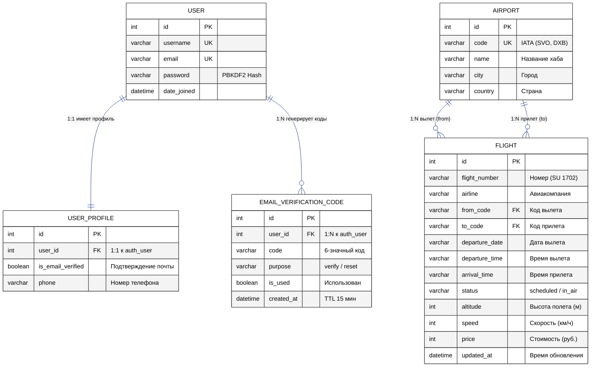

# ER-диаграмма базы данных (Entity-Relationship Diagram)

В данном документе представлена актуальная **ER-диаграмма реляционной базы данных** веб-сервиса **Flight Tracker** (СУБД SQLite 3 / Django ORM).

Схема оптимизирована по ГОСТу: в сущность **FLIGHT** включены все необходимые атрибуты телеметрии и актуализации данных (`departure_date`, `altitude`, `speed`, `updated_at`, `price`).

---

## 1. Готовое изображение ER-диаграммы (для вставки в отчёт Word)

*Файлы диаграммы высокой четкости (300 DPI) для пояснительной записки:*
* **Редактируемый проект Draw.io:** [`docs/er_diagram.drawio`](file:///c:/Users/faizr/PycharmProjects/KursovayaRPI/docs/er_diagram.drawio)
* **PNG формат:** [`docs/er_diagram.png`](file:///c:/Users/faizr/PycharmProjects/KursovayaRPI/docs/er_diagram.png)
* **Векторный SVG формат:** [`docs/er_diagram.svg`](file:///c:/Users/faizr/PycharmProjects/KursovayaRPI/docs/er_diagram.svg)

---

## 2. Актуальная ER-диаграмма в нотации Mermaid

---

## 3. Сводная таблица сущности FLIGHT

| Поле | Тип данных | Назначение |
| :--- | :--- | :--- |
| `id` | `INTEGER` (PK) | Уникальный идентификатор рейса |
| `flight_number` | `VARCHAR(30)` | Номер рейса (например, SU 1702) |
| `airline` | `VARCHAR(100)` | Название авиакомпании |
| `from_code` | `VARCHAR(10)` (FK) | Код аэропорта вылета (связь 1:N с Airport) |
| `to_code` | `VARCHAR(10)` (FK) | Код аэропорта прилёта (связь 1:N с Airport) |
| `departure_date` | `VARCHAR(20)` | **Дата вылета (ГГГГ-ММ-ДД)** |
| `departure_time` | `VARCHAR(20)` | Время вылета (ЧЧ:ММ) |
| `arrival_time` | `VARCHAR(20)` | Время прилёта (ЧЧ:ММ) |
| `status` | `VARCHAR(30)` | Статус рейса (`scheduled`, `in_air`, `landed`) |
| `altitude` | `INTEGER` | **Телеметрия: текущая высота (м)** |
| `speed` | `INTEGER` | **Телеметрия: текущая скорость (км/ч)** |
| `price` | `INTEGER` | **Стоимость билета в рублях** |
| `updated_at` | `DATETIME` | **Временная метка последнего обновления** |
