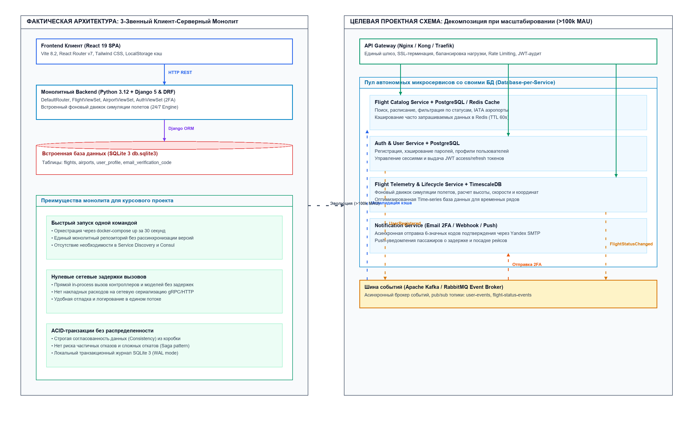

# Микросервисная архитектура и эволюционный переход (Microservices Architecture)

В данном документе представлен архитектурный анализ перехода от фактического клиент-серверного монолита веб-сервиса **Flight Tracker** («Разработка веб-интерфейса для информационного сервиса об авиарейсах на React») к распределённой микросервисной архитектуре при масштабировании нагрузки (>100k MAU) в соответствии с требованиями дисциплины «Разработка программных интерфейсов» (РПИ).

---

## 1. Готовое изображение микросервисной архитектуры (для отчёта Word/PDF)



*Файлы диаграммы высокой чёткости (300 DPI) на чистом непрозрачном белом фоне:*
* **Редактируемый проект Draw.io:** [`docs/microservices_architecture.drawio`](file:///c:/Users/faizr/PycharmProjects/KursovayaRPI/docs/microservices_architecture.drawio)
* **Mermaid исходник:** [`docs/microservices_architecture.mmd`](file:///c:/Users/faizr/PycharmProjects/KursovayaRPI/docs/microservices_architecture.mmd)
* **PNG формат:** [`docs/microservices_architecture.png`](file:///c:/Users/faizr/PycharmProjects/KursovayaRPI/docs/microservices_architecture.png)
* **Векторный SVG формат:** [`docs/microservices_architecture.svg`](file:///c:/Users/faizr/PycharmProjects/KursovayaRPI/docs/microservices_architecture.svg)

---

## 2. Диаграмма в нотации Mermaid

```mermaid
flowchart TB
    subgraph PANEL_MONOLITH["ФАКТИЧЕСКАЯ АРХИТЕКТУРА: 3-Звенный Клиент-Серверный Монолит"]
        direction TB
        M_CLIENT["Frontend Клиент (React 19 SPA + Vite 8.2)"]
        M_SERVER["Монолитный Backend (Python 3.12 + Django 5 & DRF)"]
        M_DB[("Встроенная база данных (SQLite 3 db.sqlite3)")]

        M_CLIENT -->|HTTP REST на единый сервер| M_SERVER
        M_SERVER -->|Прямой доступ через Django ORM| M_DB

        subgraph M_BENEFITS["Преимущества монолита для курсового проекта"]
            B1["Быстрый запуск одной командой (Docker Compose)"]
            B2["Нулевые сетевые задержки и простота отладки"]
            B3["Строгие ACID-транзакции без распределенности"]
        end
    end

    subgraph PANEL_MICRO["ЦЕЛЕВАЯ ПРОЕКТНАЯ СХЕМА: Декомпозиция при масштабировании (>100k MAU)"]
        direction TB
        GW["API Gateway (Nginx / Kong) - Единый шлюз, SSL, балансировка"]

        subgraph MS_SERVICES["Пул автономных микросервисов со своими БД (Database-per-Service)"]
            MS_FLIGHTS["Flight Service (Каталог и поиск рейсов) + PostgreSQL / Redis Cache"]
            MS_AUTH["Auth & User Service (Управление профилями) + PostgreSQL"]
            MS_TRACK["Flight Telemetry & Lifecycle Service + TimescaleDB"]
            MS_NOTIF["Notification Service (Email 2FA / Webhook / Push)"]
        end

        BUS["Шина событий (Apache Kafka / RabbitMQ)"]

        GW --> MS_FLIGHTS
        GW --> MS_AUTH
        GW --> MS_TRACK

        MS_AUTH -.->|Событие UserRegistered (2FA)| BUS
        MS_TRACK -.->|Событие FlightStatusChanged| BUS
        BUS -.->|Отправка email с кодом 2FA| MS_NOTIF
        BUS -.->|Инвалидация кэша расписаний| MS_FLIGHTS
    end

    PANEL_MONOLITH -.->|Эволюционный переход при росте нагрузки| PANEL_MICRO
```

---

## 3. Обоснование выбора архитектурных решений

### 1. Фактическая архитектура (3-звенный монолит)
Для учебного и прототипного уровня курсового проекта реализован классический модульный монолит:
* **Клиент:** React 19 SPA с клиентской маршрутизацией Vite и Tailwind CSS.
* **Сервер:** Единый бэкенд на Python 3.12 + Django 5 & DRF.
* **База данных:** Реляционная СУБД SQLite 3 с прямым in-process доступом через Django ORM.

#### Ключевые преимущества монолита в рамках курсового проекта:
1. **Быстрый запуск одной командой:** Оркестрация через `docker-compose up` за считанные секунды без необходимости разворачивать распределённую инфраструктуру (Consul, Envoy, ZooKeeper, Kafka).
2. **Нулевые сетевые задержки вызовов:** Взаимодействие модулей `accounts`, `flights` и `services` происходит в общем адресном пространстве процесса без сетевых накладных расходов.
3. **Строгая согласованность данных (ACID):** Транзакции выполняются атомарно локальным движком базы данных, исключая сложную распределённую координацию (2PC или Saga).

---

### 2. Целевая микросервисная архитектура (>100k MAU)
При росте аудитории до 100+ тысяч активных пользователей в месяц монолит эволюционно декомпозируется на независимые сервисы по паттерну **Database-per-Service**:

1. **API Gateway (Nginx / Kong):**
   - Единая точка входа для клиентов.
   - SSL-терминация, балансировка нагрузки (Round Robin / Least Connections).
   - Ограничение частоты запросов (Rate Limiting) и валидация JWT-токенов.

2. **Flight Catalog Service (Каталог и поиск рейсов):**
   - Выделенная база данных PostgreSQL (Master-Slave репликация).
   - Кэширующий слой **Redis** для мгновенной выдачи популярных направлений и расписаний (TTL 60 секунд).

3. **Auth & User Service (Сервис аутентификации и профилей):**
   - Изолированное хранилище аккаунтов, хэшей паролей PBKDF2 и персональных данных в PostgreSQL.
   - Выпуск и верификация асимметричных JWT токенов (RS256).

4. **Flight Telemetry & Lifecycle Service (Телеметрия рейсов в реальном времени):**
   - Фоновый движок симуляции этапов полётов и расчёта координат/высоты/скорости.
   - Использование специализированной time-series СУБД **TimescaleDB** для эффективной записи истории телеметрии.

5. **Notification Service (Сервис уведомлений):**
   - Асинхронная доставка email-кодов двухфакторной аутентификации (Yandex SMTP).
   - Рассылка push-уведомлений и оповещений о смене статусов рейсов пассажирам.

6. **Шина событий (Apache Kafka / RabbitMQ Event Broker):**
   - Обеспечивает слабую связанность (loose coupling) микросервисов.
   - Топик `user-registered` инициирует отправку 2FA-письма через Notification Service.
   - Топик `flight-status-changed` инициирует сброс устаревшего кэша в каталоге рейсов и отправку оповещений.
