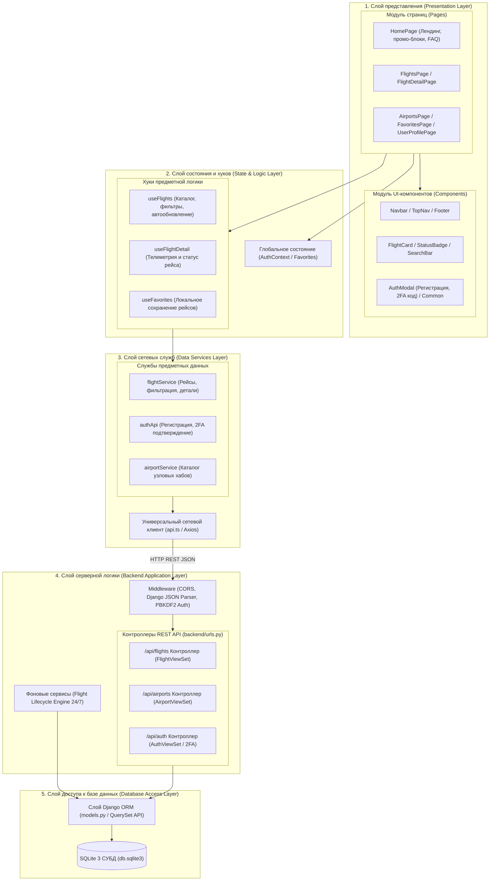

# Модульная диаграмма программного комплекса (UML Component / Module Diagram)

В данном документе представлена **Модульная диаграмма** веб-сервиса **Flight Tracker** («Разработка веб-интерфейса для информационного сервиса об авиарейсах на React»), спроектированная в строгом соответствии с 5-слойной моделью декомпозиции программной инженерии по дисциплине «Разработка программных интерфейсов» (РПИ).

---

## 1. Готовое изображение модульной диаграммы (для отчёта Word/PDF)

*Файлы модульной диаграммы высокой чёткости (300 DPI) на чистом непрозрачном белом фоне:*
* **Редактируемый проект Draw.io:** [`docs/module_diagram.drawio`](file:///c:/Users/faizr/PycharmProjects/KursovayaRPI/docs/module_diagram.drawio)
* **PNG формат:** [`docs/module_diagram.png`](file:///c:/Users/faizr/PycharmProjects/KursovayaRPI/docs/module_diagram.png)
* **Векторный SVG формат:** [`docs/module_diagram.svg`](file:///c:/Users/faizr/PycharmProjects/KursovayaRPI/docs/module_diagram.svg)

---

## 2. Модульная диаграмма в нотации Mermaid

---

## 3. Детальное описание 5 модульных слоёв

### 1. Слой представления (Presentation Layer)
* **Модуль страниц (`src/pages/`):** Входные точки маршрутизации SPA приложения (`HomePage`, `FlightsPage`, `FlightDetailPage`, `AirportsPage`, `FavoritesPage`, `UserProfilePage`).
* **Модуль UI-компонентов (`src/components/`):** Визуальные элементы интерфейса: каркасная навигация (`Navbar`, `Footer`, `TopNav`), виджеты рейсов (`FlightCard`, `StatusBadge`, `SearchBar`), модальные окна аутентификации и подтверждения почты (`AuthModal`), вспомогательные состояния (`LoadingSkeleton`, `ErrorState`, `EmptyState`).

### 2. Слой состояния и хуков (State & Logic Layer)
* **Глобальное состояние (`src/context/`):** `AuthContext` для сквозного контроля сессии пользователя и флага верификации почты; `localStorage` для кэширования избранных рейсов и токенов; `react-router-dom v7` для управления маршрутами.
* **Пользовательские хуки (`src/hooks/`):** Инкапсулируют бизнес-логику интерфейса: `useFlights` (выборка, фильтрация, таймеры автообновления), `useFlightDetail` (детализация и расчёт времени), `useFavorites` (сохранение в локальное хранилище), `useDebounce` (отложенный поисковый ввод).

### 3. Слой сетевых служб (Data Services Layer)
* **Сетевой клиент (`src/services/api.ts`):** Универсальный HTTP-клиент (Axios/Fetch) с централизованной настройкой базового URL (`/api/`), интерцепторами заголовков, обработкой кодов 401/403/500 и механизмом fallback-кэширования.
* **Службы предметных данных:**
  - `flightService`: методы получения списка рейсов, пагинации, поиска по городам и получения рейса по идентификатору.
  - `authApi`: методы регистрации, отправки и проверки 6-значного кода подтверждения email, входа и выхода.
  - `airportService`: поставщик справочника узловых аэропортов.

### 4. Слой серверной логики (Backend Application Layer)
* **Маршрутизация и Middleware (`backend/urls.py`):** Диспетчер `DefaultRouter`, проверка CORS заголовков, парсер JSON-тел запросов, шифрование паролей PBKDF2.
* **REST API Контроллеры (ViewSets):** `FlightViewSet`, `AirportViewSet`, `AuthViewSet` — обработка входящих HTTP-запросов, валидация через сериализаторы `ModelSerializer`.
* **Фоновые сервисы движка (`backend/services/flight_lifecycle.py`):** Движок жизненного цикла рейсов 24/7 (симуляция полетов), планировщик очистки архива `cleanup_archived_flights` (старше 14 дней), генератор одноразовых кодов email.

### 5. Слой доступа к базе данных (Database Access Layer)
* **Слой Django ORM (`models.py`, QuerySet API):** Обеспечивает безопасное объектно-реляционное взаимодействие, исключает возможность SQL-инъекций, гарантирует транзакционность (ACID).
* **СУБД SQLite 3 (`db.sqlite3`):** Локальная реляционная база данных, хранящая таблицы `Flight`, `Airport`, `UserProfile`, `EmailVerificationCode`.
