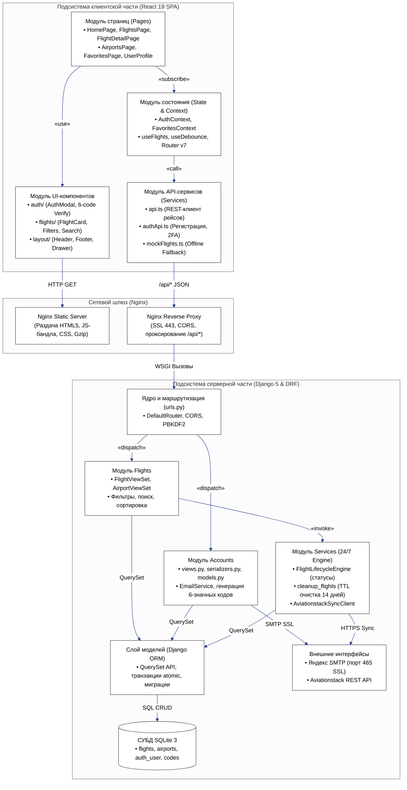

# Модульная диаграмма программного комплекса (UML Component / Module Diagram)

В данном документе представлена **Модульная диаграмма** веб-сервиса **Flight Tracker** («Разработка веб-интерфейса для информационного сервиса об авиарейсах на React»), спроектированная в строгом соответствии со стандартами UML и принципами модульной декомпозиции программной инженерии по дисциплине «Разработка программных интерфейсов» (РПИ).

---

## 1. Готовое изображение модульной диаграммы (для отчёта Word/PDF)

*Файлы модульной диаграммы высокой чёткости (300 DPI) на чистом белом фоне:*
* **Редактируемый проект Draw.io:** [`docs/module_diagram.drawio`](file:///c:/Users/faizr/PycharmProjects/KursovayaRPI/docs/module_diagram.drawio)
* **PNG формат:** [`docs/module_diagram.png`](file:///c:/Users/faizr/PycharmProjects/KursovayaRPI/docs/module_diagram.png)
* **Векторный SVG формат:** [`docs/module_diagram.svg`](file:///c:/Users/faizr/PycharmProjects/KursovayaRPI/docs/module_diagram.svg)

---

## 2. Модульная диаграмма в нотации Mermaid

---

## 3. Описание модульной декомпозиции программного комплекса

### 3.1 Подсистема клиентской части (Frontend — React 19)
* **Модуль страниц (`src/pages/`):** Высокоуровневые экранные формы (`HomePage`, `FlightsPage`, `FlightDetailPage`, `AirportsPage`, `FavoritesPage`, `UserProfilePage`, `AboutPage`, `NotFoundPage`). Модуль отвечает за композицию интерфейса, обработку параметров маршрута (`useParams`) и передачу данных в UI-компоненты.
* **Модуль компонентов (`src/components/`):** Иерархия переиспользуемых визуальных блоков:
  * `auth/` — диалоговые формы входа, регистрации и 6-ячеечного ввода кода подтверждения;
  * `flights/` — интерактивные карточки рейсов, переключатели статусов («В полёте», «Ожидает взлёта», «Прибыл»), селектор авиакомпаний;
  * `layout/` — шапка со счётчиком избранного, подвал и плавная боковая шторка (Drawer);
  * `common/` — скелетоны ожидания (`LoadingSkeleton`) и заглушки отсутствия данных (`EmptyState`).
* **Модуль состояния и хуков (`src/context/`, `src/hooks/`):** Обеспечивает единый источник правды (Single Source of Truth). `AuthContext` сохраняет токен и профиль пользователя; `FavoritesContext` синхронизирует закладки с `localStorage`; хуки `useDebounce` снижают нагрузку на сервер при поиске рейсов.
* **Модуль API-сервисов (`src/services/`):** Сетевой модуль (`api.ts`, `authApi.ts`) инкапсулирует вызовы HTTP, преобразует snake_case сервера в camelCase интерфейса и активирует `mockFlights.ts` при задержке ответа свыше 2 секунд.

### 3.2 Сетевой шлюз (Gateway — Nginx)
* **Nginx Static Server:** Обеспечивает высокоскоростную отдачу скомпилированных ассетов (HTML, JavaScript, CSS, шрифты Benzin и TT Travels) со сжатием Gzip/Brotli и клиентским кэшированием.
* **Nginx Reverse Proxy:** Выступает единой точкой входа (`Single Point of Entry`), экранирует внутренний контур Django, терминарует SSL/TLS и настраивает заголовки CORS.

### 3.3 Подсистема серверной части (Backend — Django 5 & DRF)
* **Модуль ядра и диспетчеризации (`backend/`):** Конфигурация параметров безопасности (`settings.py`), корневой URL-диспетчер (`urls.py`) и генерация схемы эндпоинтов на базе DRF `DefaultRouter`.
* **Модуль `flights` (`backend/flights/`):** Реализует REST API управления авиарейсами: выборка с многокритериальной фильтрацией (город, аэропорт, статус, перевозчик), динамическая сортировка по стоимости и времени вылета.
* **Модуль `accounts` (`backend/accounts/`):** Отвечает за аутентификацию и безопасность: регистрация новых пользователей, хэширование паролей по стандарту PBKDF2-SHA256, генерация криптостойких 6-значных кодов с TTL 15 минут.
* **Модуль фоновых служб (`Lifecycle Engine & Services`):** Независимый демон 24/7 (`update_dynamic_flight_lifecycle`), который автоматически рассчитывает текущее положение и статус борта по системному времени, и фоновая команда `cleanup_flights`, удаляющая рейсы старше 14 дней.
* **Слой моделей (`Django ORM`):** Гарантирует типобезопасный доступ к реляционным таблицам без прямых сырых SQL-вызовов, обеспечивая ACID-транзакции.
* **СУБД SQLite 3:** Локальное дисковое реляционное хранилище со структурированными индексами.
* **Внешние интерфейсы:** Почтовый шлюз Яндекс SMTP (порт 465 SSL) для отправки кодов 2FA и клиент Aviationstack API для периодической синхронизации глобального расписания.
