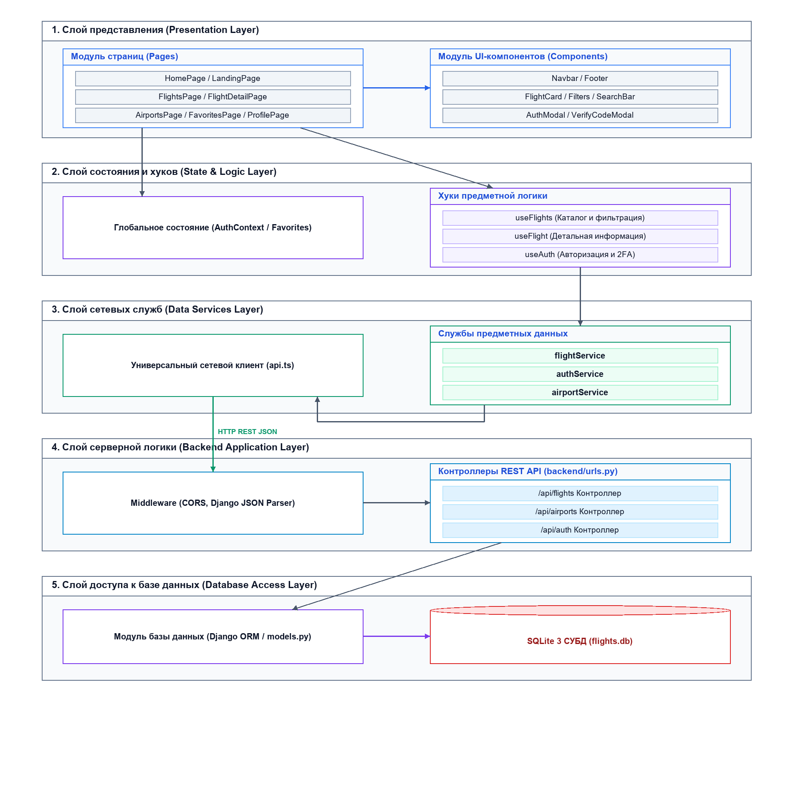
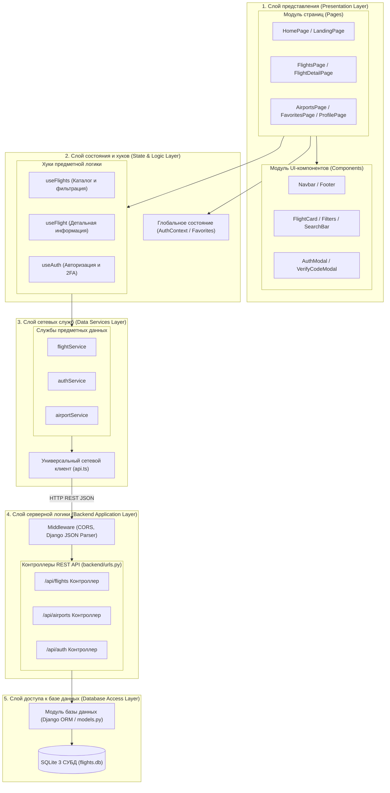

# Модульная диаграмма программного комплекса (Modular Diagram)

В данном документе представлена **Модульная диаграмма** веб-сервиса **Flight Tracker** («Разработка веб-интерфейса для информационного сервиса об авиарейсах на React»), спроектированная в строгом соответствии с 5-слойной моделью декомпозиции программной инженерии по дисциплине «Разработка программных интерфейсов» (РПИ).

---

## 1. Готовое изображение модульной диаграммы (для отчёта Word/PDF)

*Файлы модульной диаграммы высокой чёткости (300 DPI) на чистом непрозрачном белом фоне:*
* **Редактируемый проект Draw.io:** [`docs/module_diagram.drawio`](file:///c:/Users/faizr/PycharmProjects/KursovayaRPI/docs/module_diagram.drawio)
* **PNG формат:** [`docs/module_diagram.png`](file:///c:/Users/faizr/PycharmProjects/KursovayaRPI/docs/module_diagram.png)
* **Векторный SVG формат:** [`docs/module_diagram.svg`](file:///c:/Users/faizr/PycharmProjects/KursovayaRPI/docs/module_diagram.svg)

---

## 2. Модульная диаграмма в нотации Mermaid

---

## 3. Описание слоёв и модулей

1. **Слой представления (Presentation Layer):**
   - **Модуль страниц (`Pages`):** `HomePage / LandingPage`, `FlightsPage / FlightDetailPage`, `AirportsPage / FavoritesPage / ProfilePage`.
   - **Модуль UI-компонентов (`Components`):** `Navbar / Footer`, `FlightCard / Filters / SearchBar`, `AuthModal / VerifyCodeModal`.
   - Отображение компонентов на страницах: `MOD_PAGES --> MOD_UI`.

2. **Слой состояния и хуков (State & Logic Layer):**
   - **Глобальное состояние (`AuthContext / Favorites`):** сквозной контекст авторизации, статуса верификации email и локального хранилища `localStorage`.
   - **Хуки предметной логики (`Hooks`):** `useFlights` (каталог и фильтрация), `useFlight` (детальная информация о рейсе), `useAuth` (авторизация и двухфакторное подтверждение почты).
   - Вызовы со слоя страниц: `MOD_PAGES --> CTX`, `MOD_PAGES --> MOD_HOOKS`.

3. **Слой сетевых служб (Data Services Layer):**
   - **Универсальный сетевой клиент (`api.ts`):** инкапсулирует вызовы HTTP/REST через Axios/Fetch, интерцепторы авторизационных заголовков и обработку ошибок.
   - **Службы предметных данных:** `flightService`, `authService`, `airportService`.
   - Поток делегирования: `MOD_HOOKS --> MOD_SVC` и `MOD_SVC --> API_CLIENT`.

4. **Слой серверной логики (Backend Application Layer):**
   - **Middleware:** CORS заголовки, парсер JSON-тел запросов, хэширование паролей PBKDF2.
   - **Контроллеры REST API (`backend/urls.py`):** `/api/flights Контроллер`, `/api/airports Контроллер`, `/api/auth Контроллер`.
   - Обращение сетевого клиента: `API_CLIENT -->|HTTP REST JSON| MID` и `MID --> MOD_ROUTERS`.

5. **Слой доступа к базе данных (Database Access Layer):**
   - **Модуль базы данных:** `Django ORM / models.py` — слой моделей, валидации и QuerySet API.
   - **СУБД:** встроенная реляционная база данных `SQLite 3` (`flights.db`).
   - Доступ к данным: `MOD_ROUTERS --> DB_MOD` и `DB_MOD --> DB_STORE`.
