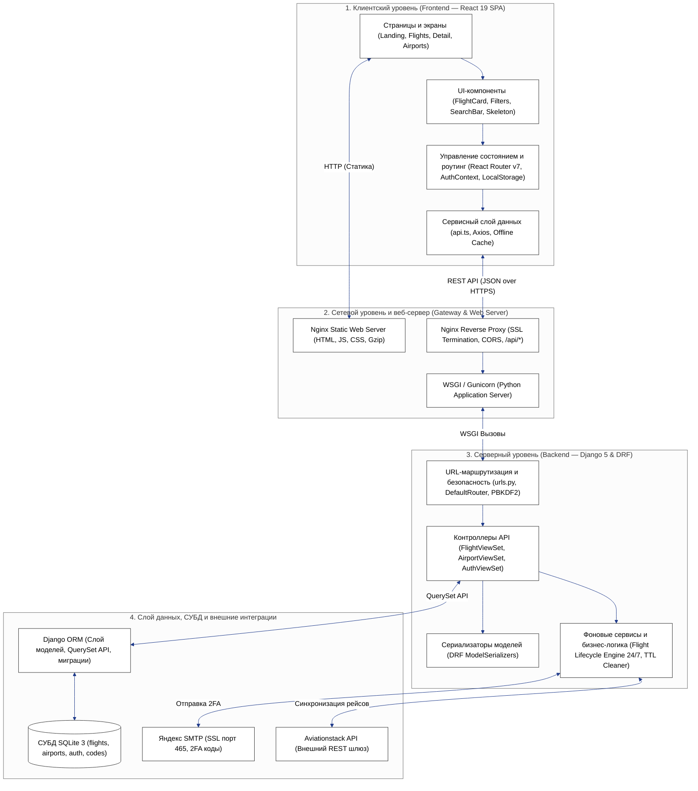

# Архитектура проекта (Project Architecture)

В данном документе представлена многоуровневая архитектура программного комплекса веб-сервиса **Flight Tracker** («Разработка веб-интерфейса для информационного сервиса об авиарейсах на React»), спроектированная в строгом соответствии с принципами чистой архитектуры, разделения ответственности (SoC) и требованиями дисциплины «Разработка программных интерфейсов» (РПИ).

---

## 1. Готовое изображение архитектуры проекта (для отчёта Word/PDF)

*Файлы архитектурной диаграммы высокой чёткости (300 DPI) на чистом белом фоне:*
* **Редактируемый проект Draw.io:** [`docs/project_architecture.drawio`](file:///c:/Users/faizr/PycharmProjects/KursovayaRPI/docs/project_architecture.drawio)
* **PNG формат:** [`docs/project_architecture.png`](file:///c:/Users/faizr/PycharmProjects/KursovayaRPI/docs/project_architecture.png)
* **Векторный SVG формат:** [`docs/project_architecture.svg`](file:///c:/Users/faizr/PycharmProjects/KursovayaRPI/docs/project_architecture.svg)

---

## 2. Диаграмма архитектуры проекта в нотации Mermaid

---

## 3. Детальное описание архитектурных уровней

### Уровень 1: Клиентский уровень (Frontend — React 19 SPA)
* **Страницы (Pages):** Полноценное одностраничное приложение (`Landing`, `Flights`, `FlightDetail`, `Airports`, `Favorites`, `About`, `NotFound`).
* **Компоненты (UI Layer):** Атомарные переиспользуемые элементы интерфейса: карточки рейсов с индикацией статуса, плашки авиакомпаний, живой поиск с debounce, мерцающие скелетоны загрузки, модальные окна и боковая шторка навигации.
* **Стейт и маршрутизация:** Маршрутизация на базе `react-router-dom v7`. Контексты `AuthContext` (авторизация, статус верификации почты) и `FavoritesContext` с локальным хранением в `localStorage`.
* **Сервисный слой данных (`src/services/api.ts`):** Инкапсулирует вызовы к REST API через Axios/Fetch, производит сериализацию/десериализацию форматов (snake_case $\leftrightarrow$ camelCase) и предоставляет fallback-кэш на случай сбоя сети.

### Уровень 2: Сетевой уровень и обратный прокси-сервер (Nginx & Gunicorn)
* **Раздача статики:** Nginx отдаёт скомпилированный бандл фронтенда с поддержкой кэширования и сжатия Gzip / Brotli.
* **Обратный прокси:** Все клиентские вызовы по маске `/api/*` прозрачно проксируются на внутренний бэкенд-сервер. Nginx обеспечивает изоляцию внутренней сети, SSL-терминацию и настройку CORS-заголовков.
* **WSGI-сервер (Gunicorn):** Обеспечивает запуск многопоточного пула воркеров для обработки Python/Django-запросов.

### Уровень 3: Серверный уровень (Backend — Django 5 & DRF)
* **URL-диспетчер и безопасность:** `urls.py` и `DefaultRouter` сопоставляют URI с контроллерами. Слой middleware осуществляет валидацию токенов и хэширование паролей по стандарту **PBKDF2-SHA256**.
* **Контроллеры (ViewSets):** `FlightViewSet` (поиск по городам/аэропортам, фильтрация по статусу и авиакомпаниям, сортировка), `AirportViewSet` (каталог узловых аэропортов), `AuthViewSet` (регистрация и двухфакторное подтверждение почты).
* **Сериализаторы (DRF Serializers):** Преобразуют реляционные объекты в структурированный JSON с валидацией полей.
* **Фоновые сервисы:** Движок симуляции полетов 24/7 (`update_dynamic_flight_lifecycle`), планировщик очистки архивных рейсов старше 14 дней (`cleanup_archived_flights`) и генератор 6-значных кодов подтверждения.

### Уровень 4: Слой доступа к данным и внешние интеграции
* **Django ORM:** Объектно-реляционное отображение (ORM), исключающее прямые небезопасные SQL-инъекции и обеспечивающее транзакционную целостность данных.
* **СУБД SQLite 3:** Локальная высокопроизводительная реляционная база данных с индексацией по ключевым полям (`IATA code`, `flight_number`, `status`).
* **Яндекс SMTP:** Интеграция с официальным почтовым шлюзом Яндекса через шифрованный канал SSL (порт 465) для отправки 6-значных кодов подтверждения регистрации.
* **Aviationstack API:** Внешний провайдер реальных данных гражданской авиации для начальной загрузки и синхронизации актуальных расписаний.
