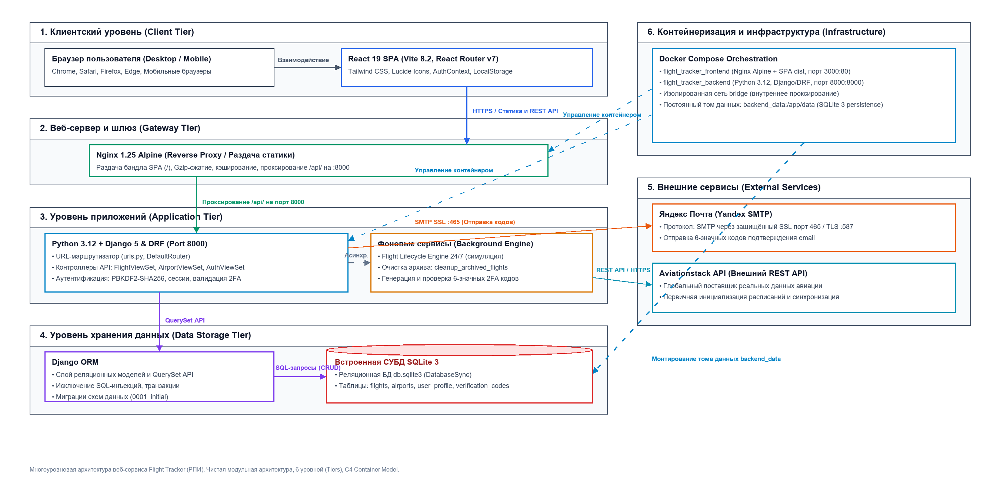

# Архитектура проекта (Project Architecture)

В данном документе представлена многоуровневая архитектура программного комплекса веб-сервиса **Flight Tracker** («Разработка веб-интерфейса для информационного сервиса об авиарейсах на React»), спроектированная в строгом соответствии с 6-уровневой архитектурной моделью (Tiers / Container Model), принципами чистой архитектуры и требованиями дисциплины «Разработка программных интерфейсов» (РПИ).

---

## 1. Изображение архитектуры проекта (для отчёта Word/PDF)



*Файлы архитектурной диаграммы высокой чёткости (300 DPI) на чистом непрозрачном белом фоне:*
* **Редактируемый проект Draw.io:** [`docs/project_architecture.drawio`](file:///c:/Users/faizr/PycharmProjects/KursovayaRPI/docs/project_architecture.drawio)
* **PNG формат:** [`docs/project_architecture.png`](file:///c:/Users/faizr/PycharmProjects/KursovayaRPI/docs/project_architecture.png)
* **Векторный SVG формат:** [`docs/project_architecture.svg`](file:///c:/Users/faizr/PycharmProjects/KursovayaRPI/docs/project_architecture.svg)

---

## 2. Диаграмма архитектуры проекта в нотации Mermaid

```mermaid
flowchart TB
    subgraph CLIENT["1. Клиентский уровень (Client Tier)"]
        BROWSER["Браузер пользователя (Desktop / Mobile)"]
        SPA["React 19 SPA (Vite 8.2, React Router v7, Tailwind CSS)"]
        BROWSER -->|Взаимодействие с интерфейсом| SPA
    end

    subgraph GATEWAY["2. Веб-сервер и шлюз (Gateway Tier)"]
        NGINX["Nginx 1.25 Alpine (Reverse Proxy / Раздача статики)"]
    end

    subgraph APP["3. Уровень приложений (Application Tier)"]
        DJANGO["Python 3.12 + Django 5 & DRF REST API (Port 8000)"]
        SERVICES["Фоновые сервисы (Flight Lifecycle Engine 24/7)"]
        DJANGO -.->|Асинхронный запуск| SERVICES
    end

    subgraph DATA["4. Уровень хранения данных (Data Storage Tier)"]
        ORM["Django ORM (Слой моделей и QuerySet API)"]
        SQLITE[("Встроенная СУБД SQLite 3 (db.sqlite3)")]
        ORM -->|SQL-запросы (CRUD)| SQLITE
    end

    subgraph EXT["5. Внешние сервисы (External Services)"]
        YANDEX["Яндекс Почта (SMTP SSL порт 465 / TLS :587)"]
        AVIATION["Aviationstack API (Внешний REST API поставщика рейсов)"]
    end

    subgraph INFRA["6. Контейнеризация и инфраструктура (Infrastructure)"]
        DOCKER["Docker Compose (Frontend + Backend + Volume)"]
    end

    SPA -->|HTTPS / Раздача статики и REST API| NGINX
    NGINX -->|Проксирование /api/ на порт 8000| DJANGO
    DJANGO -->|Запросы через QuerySet API| ORM
    DJANGO -.->|SMTP SSL :465 отправка кодов 2FA| YANDEX
    SERVICES -.->|Синхронизация рейсов / HTTPS| AVIATION
    DOCKER -.->|Управление контейнером| NGINX
    DOCKER -.->|Управление контейнером| DJANGO
    DOCKER -.->|Монтирование тома данных backend_data| SQLITE
```

---

## 3. Детальное описание 6 архитектурных уровней (Tiers)

### 1. Клиентский уровень (Client Tier)
* **Браузер пользователя:** Доступ пользователей с ПК и мобильных устройств (Google Chrome, Apple Safari, Mozilla Firefox, Microsoft Edge).
* **React 19 SPA:** Одностраничное приложение на React 19, собранное с помощью сборщика Vite 8.2. Обеспечивает мгновенный клиентский переход между страницами (`react-router-dom v7`), адаптивный дизайн на Tailwind CSS, состояние через Context API (`AuthContext`, `FavoritesContext`), а также локальный кэш избранного и токенов в `localStorage`.

### 2. Веб-сервер и шлюз (Gateway Tier)
* **Nginx 1.25 Alpine:** Высокопроизводительный обратный прокси-сервер и веб-сервер.
  - Раздаёт скомпилированный бандл фронтенда (`/`) с использованием правила `try_files $uri $uri/ /index.html` для поддержки SPA-маршрутизации.
  - Осуществляет сжатие трафика (Gzip) и кэширование статических ассетов (изображения, шрифты, стили).
  - Прозрачно перенаправляет все входящие вызовы API (`location /api/`) на внутренний бэкенд (`http://backend:8000/api/`).

### 3. Уровень приложений (Application Tier)
* **Python 3.12 + Django 5 & Django REST Framework (Порт 8000):**
  - **URL-маршрутизатор:** Диспетчеризация запросов через `urls.py` и `DefaultRouter`.
  - **API Контроллеры (ViewSets):** `FlightViewSet` (фильтрация, поиск, пагинация, сортировка), `AirportViewSet` (каталог аэропортов), `AuthViewSet` (регистрация с подтверждением почты, вход, выход, профиль).
  - **Безопасность:** Хэширование паролей алгоритмом **PBKDF2-SHA256**, валидация одноразовых 6-значных кодов с ограничением срока действия (15 минут).
* **Фоновые сервисы (Background Engine):**
  - **Flight Lifecycle Engine 24/7:** Фоновый процесс симуляции жизненного цикла полётов в реальном времени (`Scheduled` $\rightarrow$ `Boarding` $\rightarrow$ `Departed` $\rightarrow$ `En Route` $\rightarrow$ `Landed` $\rightarrow$ `Arrived`).
  - **Очистка архива:** Функция `cleanup_archived_flights()` удаляет рейсы со статусом `Arrived` или `Cancelled` старше 14 дней.

### 4. Уровень хранения данных (Data Storage Tier)
* **Django ORM:** Уровень абстракции доступа к данным. Преобразует операции Python-кода в оптимизированные SQL-запросы, защищает от SQL-инъекций и обеспечивает транзакционную целостность данных.
* **Встроенная СУБД SQLite 3 (`db.sqlite3`):** Локальная реляционная база данных, хранящая таблицы `flights`, `airports`, `user_profile`, `email_verification_code`. Файл базы данных вынесен в постоянный том `backend_data`, гарантирующий сохранность данных при перезапуске контейнеров.

### 5. Внешние сервисы (External Services)
* **Яндекс Почта (Yandex SMTP):** Интеграция с почтовым шлюзом Яндекса по защищённому протоколу SSL (порт 465) / TLS (порт 587) для мгновенной доставки 6-значных кодов подтверждения email-адреса.
* **Aviationstack API:** Внешний REST API провайдер реальных данных гражданской авиации для начального наполнения базы данных актуальными расписаниями и информацией о терминалах.

### 6. Контейнеризация и инфраструктура (Infrastructure)
* **Docker Compose:** Инструмент декларативного развёртывания и оркестрации мультиконтейнерного приложения:
  - Сервис `flight_tracker_frontend`: легковесный контейнер `nginx:alpine` с пробросом портов `3000:80`.
  - Сервис `flight_tracker_backend`: контейнер `python:3.12-slim` с пробросом портов `8000:8000`.
  - Изолированная виртуальная сеть `bridge` для безопасного межсервисного взаимодействия.
  - Постоянный том `backend_data:/app/data` для надёжного хранения базы данных SQLite 3.
