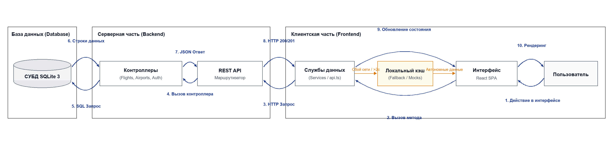

# Диаграмма запросов (Request Flow Diagram)

Диаграмма прохождения запросов между клиентом, сервером и базой данных выполнена в строгом академическом стиле на **чистом белом фоне** для вставки в отчет по курсовой работе.

---

## 1. Готовое изображение диаграммы (для вставки в отчёт Word)

*Файлы диаграммы высокой четкости (300 DPI) для пояснительной записки:*
* **PNG формат:** [`docs/request_flow_diagram.png`](file:///c:/Users/faizr/PycharmProjects/KursovayaRPI/docs/request_flow_diagram.png)
* **Векторный SVG формат:** [`docs/request_flow_diagram.svg`](file:///c:/Users/faizr/PycharmProjects/KursovayaRPI/docs/request_flow_diagram.svg)

---

## 2. Диаграмма запросов (Mermaid-код)

```mermaid
%%{init: {'theme': 'neutral', 'themeVariables': {'darkMode': false, 'background': '#FFFFFF', 'mainBkg': '#FFFFFF', 'nodeBorder': '#333333', 'textColor': '#000000', 'lineColor': '#1E3A8A'}}}%%
flowchart LR
    subgraph DB ["База данных (Database)"]
        SQLite[("СУБД SQLite 3")]
    end

    subgraph Backend ["Серверная часть (Backend)"]
        Controllers["Контроллеры (Flights, Airports, Auth)"]
        Router["REST API Маршрутизатор"]
    end

    subgraph Frontend ["Клиентская часть (Frontend)"]
        Services["Службы данных (Services)"]
        Fallback["Локальный кэш (Fallback)"]
        UI["Интерфейс React SPA"]
        User["Пользователь"]
    end

    %% Прямой поток запроса (Нижний контур: 1 -> 5)
    User -->|"1. Действие в интерфейсе"| UI
    UI -->|"2. Вызов метода"| Services
    Services -->|"3. HTTP Запрос"| Router
    Router -->|"4. Вызов контроллера"| Controllers
    Controllers -->|"5. SQL Запрос"| SQLite

    %% Обратный поток ответа (Верхний контур: 6 -> 10)
    SQLite -->|"6. Строки данных"| Controllers
    Controllers -->|"7. JSON Ответ"| Router
    Router -->|"8. HTTP 200/201"| Services
    Services -->|"9. Обновление состояния"| UI
    UI -->|"10. Рендеринг"| User

    %% Альтернативный автономный контур (Fallback)
    Services -.->|"Сбой сети / Таймаут > 2c"| Fallback
    Fallback -.->|"Автономные данные"| UI

    %% Стилизация
    classDef default fill:#F8FAFC,stroke:#94A3B8,stroke-width:1.5px,color:#1E293B;
    classDef box fill:#FFFFFF,stroke:#64748B,stroke-width:1px,stroke-dasharray: 4 4;
    classDef db fill:#F1F5F9,stroke:#475569,stroke-width:2px;
    classDef fallback fill:#FFFBEB,stroke:#F59E0B,stroke-width:1.5px,stroke-dasharray: 3 3;

    class SQLite db;
    class Fallback fallback;
```

---

## 2. Описание этапов жизненного цикла запроса

1. **`1. Действие в интерфейсе`:** Пользователь инициирует событие в браузере (нажатие кнопки поиска, фильтрация рейсов, отправка формы входа, добавление в избранное).
2. **`2. Вызов метода`:** React-компонент вызывает соответствующую функцию сервисного уровня (`fetchFlights()`, `login()`, `register()`).
3. **`3. HTTP Запрос`:** Служба формирует асинхронный HTTP-запрос (метод GET/POST, заголовки, JSON-тело) и отправляет его на эндпоинт REST API.
4. **`4. Вызов контроллера`:** Диспетчер URL (`urls.py`) сопоставляет маршрут и передает управление соответствующему классу представления (`FlightListAPIView`, `LoginAPIView`).
5. **`5. SQL Запрос`:** Контроллер через Django ORM генерирует SQL-инструкцию (`SELECT`, `INSERT`, `UPDATE`) к СУБД.
6. **`6. Строки данных`:** СУБД SQLite 3 выполняет запрос и возвращает сырые строки таблицы контроллеру.
7. **`7. JSON Ответ`:** Сериализатор валидирует данные, приводит ключи к нотации camelCase и формирует структурированный JSON-ответ.
8. **`8. HTTP 200/201`:** Маршрутизатор возвращает клиенту HTTP-ответ с кодом статуса (`200 OK`, `201 Created` или код ошибки `400/404`).
9. **`9. Обновление состояния`:** Сервисный слой возвращает данные в React Context / хук `useState`, запуская реактивное обновление состояния.
10. **`10. Рендеринг`:** React перерисовывает виртуальный DOM и отображает обновленный интерфейс пользователю со скоростью 60 FPS.

* **Автономный режим (Fallback):** В случае отсутствия подключения к интернету или таймаута сети (> 2 секунд) сервисный слой автоматически перехватывает ошибку (`catch`) и отдаёт данные из локального кеша (моковые рейсы), гарантируя непрерывность работы интерфейса (Offline First / Graceful Degradation).
