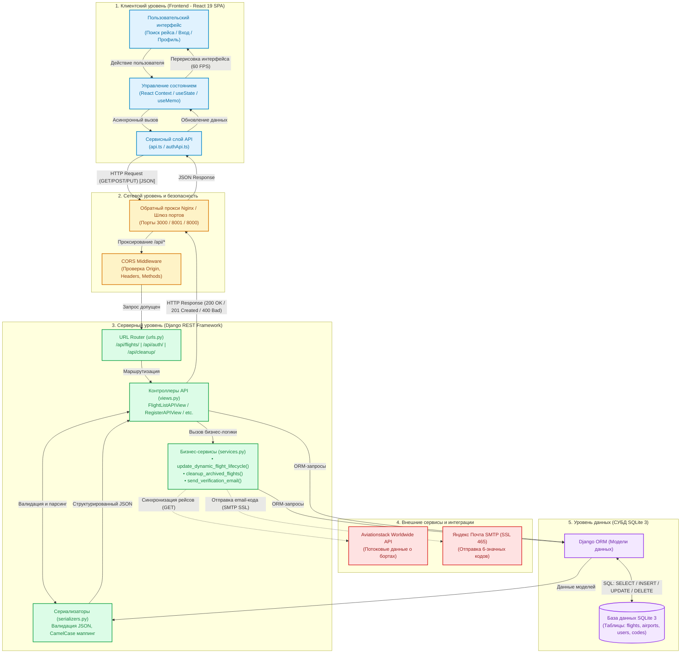

# Диаграмма запросов (Request Flow Diagram)

В данном документе представлена подробная **диаграмма прохождения клиент-серверных HTTP/REST запросов** веб-сервиса информационного отслеживания авиарейсов **Flight Tracker**.

Диаграмма описывает полный жизненный цикл входящего запроса: от действий пользователя в пользовательском интерфейсе React до маршрутизации, бизнес-логики, работы с базой данных, обращения к внешним шлюзам (Aviationstack, Яндекс SMTP) и возврата JSON-ответа.

---

## 1. Диаграмма потока запросов (Mermaid Flowchart)

---

## 2. Пошаговое описание жизненного цикла запроса

### Шаг 1: Инициация на клиенте (Frontend)
1. Пользователь выполняет действие (например, вводит поисковый запрос *«Сочи»* на табло рейсов или нажимает кнопку *«Зарегистрироваться»*).
2. React-компонент обращается к модулю сервисов (`frontend/src/services/api.ts` или `authApi.ts`).
3. Метод формирует HTTP-запрос методом `GET`, `POST` или `PUT` с заголовками `Content-Type: application/json` и, при наличии авторизации, токеном сессии.

### Шаг 2: Сетевая маршрутизация и фильтрация CORS
1. Запрос поступает на сетевой шлюз (в продакшене — обратный прокси **Nginx**, локально — напрямую на dev-сервер Django `127.0.0.1:8001`).
2. Nginx проверяет URL: запросы с префиксом `/api/` проксируются на внутренний бэкенд-сервер `http://backend:8000/api/`.
3. В Django запрос перехватывается промежуточным ПО `corsheaders.middleware.CorsMiddleware`. Проверяется белый список доверенных источников (`CORS_ALLOWED_ORIGINS = ['http://localhost:3000', ...]`). При успешной проверке запросу добавляются заголовки доступа.

### Шаг 3: Маршрутизация URL (`urls.py`)
1. Запрос анализируется корневым маршрутизатором `backend/urls.py`, который разделяет потоки:
   * `/api/flights/` $\rightarrow$ приложение `flights.urls`;
   * `/api/auth/` $\rightarrow$ приложение `accounts.urls`.
2. Запрос передается соответствующему классу представления (View), наследующемуся от `rest_framework.views.APIView`.

### Шаг 4: Выполнение бизнес-логики и интеграций (Views & Services)
В зависимости от эндпоинта выполняются специализированные сервисные сценарии:
* **При запросе рейсов (`/api/flights/`):**
  Автоматически вызывается `update_dynamic_flight_lifecycle()`, который рассчитывает актуальные статусы бортов по текущему времени и выполняет `cleanup_archived_flights(days_retention=14)` для автоочистки старых рейсов.
* **При регистрации (`/api/auth/register/`):**
  Создается учетная запись, генерируется криптостойкий 6-значный код и инициируется отправка через Яндекс SMTP SSL (`smtp.yandex.ru:465`).
* **При синхронизации (`/api/sync-aviationstack/`):**
  Сервер выполняет внешний GET-запрос к API Aviationstack и обновляет локальную базу.

### Шаг 5: Слой работы с базой данных (Django ORM & SQLite)
1. Представления обращаются к моделям данных (`Flight`, `Airport`, `User`, `UserProfile`, `EmailVerificationCode`).
2. Django ORM транслирует методы Python (`filter()`, `update_or_create()`, `delete()`) в оптимизированные SQL-инструкции для SQLite.
3. База данных выполняет запрос и возвращает кортежи строк.

### Шаг 6: Сериализация и обратный ответ клиенту
1. Django REST Framework сериализатор (`FlightSerializer` и др.) преобразует объекты моделей в JSON-структуру, трансформируя snake_case полей БД в camelCase для полного соответствия интерфейсам TypeScript.
2. Формируется HTTP-ответ со статус-кодом:
   * `200 OK` — успешное чтение или обновление данных;
   * `201 Created` — успешное создание объекта (пользователя, рейса);
   * `400 Bad Request` — ошибка валидации входных данных (неверный пароль, невалидный email);
   * `404 Not Found` — запрашиваемый рейс не найден в базе.
3. Клиентский сервис React принимает ответ, обновляет состояние приложения (`Context` / `State`), и интерфейс мгновенно отображает актуальные данные пользователю.

---

## 3. Таблица основных REST API запросов системы

| Метод | URL Эндпоинта | Передаваемые параметры | Назначение | Коды ответа |
| :---: | :--- | :--- | :--- | :---: |
| **GET** | `/api/flights/` | `search`, `status`, `airline`, `ordering` | Получение списка рейсов с фильтрацией и симуляцией статусов | `200 OK` |
| **GET** | `/api/flights/<id>/` | `flight_id` (slug в URL) | Детальная карточка конкретного рейса | `200`, `404` |
| **GET** | `/api/airports/` | — | Каталог узловых аэропортов и хабов | `200 OK` |
| **POST**| `/api/sync-aviationstack/` | `{ limit: 25 }` | Загрузка живых рейсов из глобального мирового API | `200 OK` |
| **POST**| `/api/cleanup/` | `{ days: 14 }` | Принудительная TTL-очистка завершённых рейсов | `200 OK` |
| **POST**| `/api/auth/register/` | `{ username, email, password }` | Регистрация пользователя и отправка email-кода | `201`, `400` |
| **POST**| `/api/auth/verify-email/` | `{ email, code }` | Подтверждение почты 6-значным кодом | `200`, `400` |
| **POST**| `/api/auth/login/` | `{ email, password }` | Аутентификация и вход в систему | `200`, `400` |
| **POST**| `/api/auth/password-reset/request/` | `{ email }` | Запрос на сброс пароля с кодом на почту | `200`, `400` |
| **POST**| `/api/auth/password-reset/confirm/` | `{ email, code, new_password }` | Установка нового пароля по проверенному коду | `200`, `400` |
| **GET** | `/api/auth/me/` | Bearer Token / Session | Получение данных текущего авторизованного пользователя | `200`, `401` |
| **PUT** | `/api/auth/me/` | `{ first_name, phone }` | Редактирование личных данных профиля | `200`, `400` |
| **GET** | `/api/status/` | — | Проверка здоровья API и счетчик записей в БД | `200 OK` |
