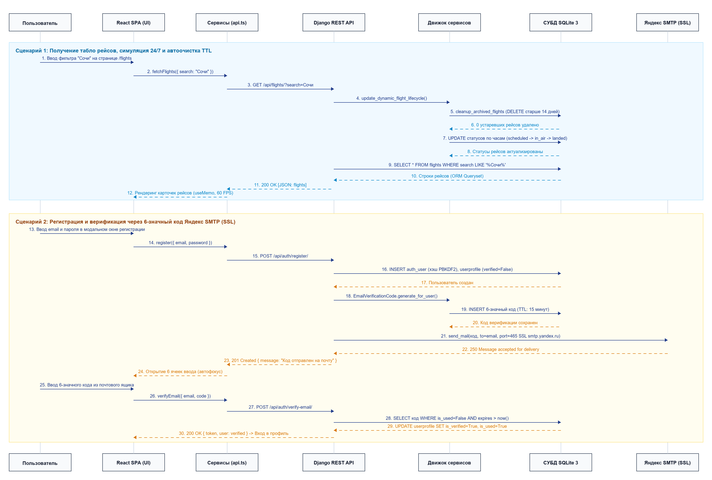
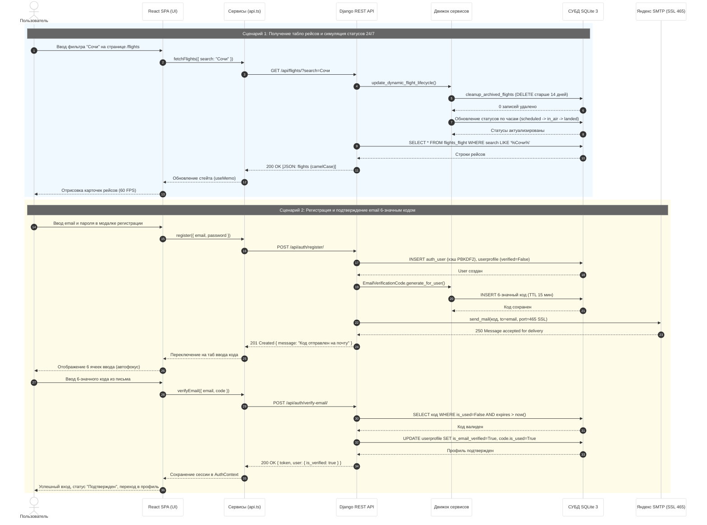

# Диаграмма последовательности (Sequence Diagram)

В данном документе представлена **UML-диаграмма последовательности (Sequence Diagram)**, иллюстрирующая сквозной жизненный цикл взаимодействий между пользователем, клиентским приложением React 19, бэкендом Django REST Framework, базой данных SQLite 3 и внешним почтовым шлюзом Яндекс SMTP.

Диаграмма охватывает два главных пользовательских сценария:
1. **Сценарий А:** Запрос табло рейсов с фильтрацией, динамическим пересчетом жизненного цикла 24/7 и автоочисткой TTL.
2. **Сценарий Б:** Регистрация пользователя с генерацией 6-значного кода и отправкой через Яндекс SMTP по защищенному протоколу SSL (порт 465).

---

## 1. Готовое изображение диаграммы (для вставки в отчёт Word)

*Файлы диаграммы высокой четкости (300 DPI) для пояснительной записки:*
* **PNG формат:** [`docs/sequence_diagram.png`](file:///c:/Users/faizr/PycharmProjects/KursovayaRPI/docs/sequence_diagram.png)
* **Векторный SVG формат:** [`docs/sequence_diagram.svg`](file:///c:/Users/faizr/PycharmProjects/KursovayaRPI/docs/sequence_diagram.svg)

---

## 2. Диаграмма последовательности (Mermaid-код)

---

## 3. Подробное описание взаимодействий

### Сценарий 1: Онлайн-мониторинг рейсов и симуляция 24/7
1. **Шаги 1–3:** Пользователь задает критерии поиска на странице `/flights`. React передает вызов в модуль `api.ts`, формирующий GET-запрос к API.
2. **Шаги 4–8:** Перед выдачей рейсов контроллер запускает фоновый движок `update_dynamic_flight_lifecycle()`:
   * Проводится проверка TTL: завершенные рейсы (`landed`/`cancelled`) старше 14 дней удаляются из базы.
   * Актуализируются статусы бортов по текущему системному времени (за 45 мин до вылета — `boarding`, во время полета — `in_air`, по прибытии — `landed`).
3. **Шаги 9–12:** Сериализатор форматирует строки из базы SQLite в JSON со свойствами в camelCase, React обновляет стейт и отрисовывает карточки со скоростью 60 FPS.

### Сценарий 2: Регистрация и 2FA подтверждение почты
1. **Шаги 13–16:** Пользователь отправляет регистрационную форму. Django хэширует пароль по стандарту **PBKDF2-SHA256** и создает записи в таблицах `auth_user` и `accounts_userprofile`.
2. **Шаги 17–22:** Генерируется случайный криптостойкий 6-значный код со сроком действия 15 минут. Инициируется SMTP-сессия с почтовым сервером Яндекса через SSL-порт 465. Пользователю отдается форма с 6 ячейками ввода.
3. **Шаги 23–29:** При вводе кода отправляется запрос верификации. Сервер проверяет актуальность кода в базе, помечает его использованным (`is_used = True`), обновляет статус профиля `is_email_verified = True` и авторизует пользователя.

